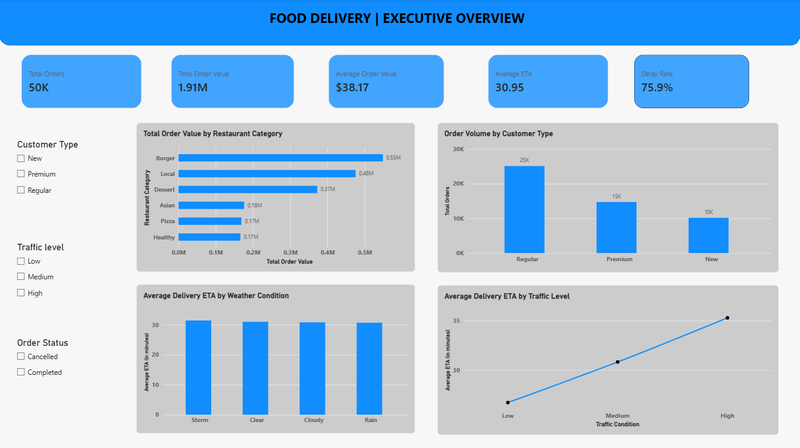

# Food Delivery Intelligence | Orders, ETA & Logistics Analytics

**An end-to-end data analytics and business intelligence project exploring 50,000 food delivery orders using Python, MySQL, and Power BI.**

This project examines customer ordering behavior, restaurant preparation efficiency, delivery-partner performance, order economics, and the relationship of traffic and weather conditions with estimated and actual delivery times. The goal is to turn operational data into actionable insights for delivery planning and service improvement.

> **Project scope:** Descriptive and diagnostic analytics, SQL business queries, interactive dashboards, and preparation for future ETA prediction. This repository does not claim a trained or validated prediction model.

## Project Overview

Food delivery operations involve several connected processes: customers place orders, restaurants prepare food, drivers complete deliveries, and changing traffic and weather conditions affect timing. This project brings these factors together to explore where delays and operational inefficiencies may occur.

**Core objectives**
- Understand order volumes, customer demographics, and loyalty segments.
- Compare restaurant categories, ratings, and preparation times.
- Evaluate driver experience, ratings, and delivery performance.
- Analyze order values, discounts, taxes, and delivery fees.
- Investigate estimated delivery time (ETA), actual delivery time, and delay rates where available.
- Compare delivery performance across traffic and weather conditions.
- Detect unusual values using descriptive statistics and the interquartile range (IQR) method.
- Present operational KPIs in an interactive Power BI report.

## Dataset

The project guide describes **50,000 order-level records** spanning six analytical domains:

| Domain | Example attributes | Analysis purpose |
|---|---|---|
| Customer | Customer ID, age, loyalty tier | Segmentation and ordering behavior |
| Restaurant | Restaurant ID, cuisine, rating, preparation time | Preparation and restaurant performance |
| Driver | Driver ID, experience, rating | Delivery-partner performance |
| Environment | Traffic, weather | Operational conditions and ETA |
| Finance | Subtotal, tax, discount, delivery fee, total amount | Order economics |
| Delivery | ETA, actual delivery time, delay | Delivery efficiency and risk |

*Note: Field names and availability must be verified against the actual CSV. The project guide presents a logical data dictionary rather than a verified CSV schema.*

## Tools & Technologies

| Tool | Purpose |
|---|---|
| **Python** | Data loading, cleaning, validation, feature engineering, EDA, and outlier detection |
| **Pandas & NumPy** | Data manipulation and numerical calculations |
| **Matplotlib & Seaborn** | Exploratory visualizations |
| **MySQL** | SQL joins, aggregations, and business analysis |
| **Power BI** | Data modeling, DAX measures, interactive dashboards, and slicers |
| **Jupyter Notebook / Google Colab** | Reproducible analysis notebooks |
| **Git & GitHub** | Version control and project documentation |

## End-to-End Workflow

```text
Raw Food Delivery Dataset
          |
          v
Data Understanding & Profiling
          |
          v
Data Cleaning & Validation
          |
          v
Feature Engineering
          |
          v
Exploratory Data Analysis
          |
          v
Customer, Restaurant & Driver Analysis
          |
          v
Traffic, Weather & Financial Analysis
          |
          v
ETA, Delay & Outlier Analysis
          |
          v
MySQL Business Analysis
          |
          v
Power BI Dashboards & DAX KPIs
          |
          v
Business Insights & Recommendations
          |
          v
Future ETA Prediction Readiness
```

## Key Analysis Areas

### 1. Customer Analytics
Explore customer age distribution, loyalty-tier order volumes, average order value, and the contribution of different customer groups to total order value.

### 2. Restaurant Analytics
Compare cuisine-level demand and order value, restaurant ratings, and preparation-time patterns. Examine associations between preparation time and delivery outcomes.

### 3. Driver Analytics
Study driver experience and ratings, order counts, average delivery time, and delay rate across experience groups.

### 4. Logistics & ETA Analytics
Analyze ETA distributions, estimated versus actual delivery time, and delivery performance under different traffic conditions. Examine preparation time and driver characteristics alongside ETA-related metrics.

### 5. Weather & Traffic Analytics
Compare delivery times and delays across weather categories and traffic levels to identify conditions that may warrant operational attention.

### 6. Financial Analytics
Evaluate total and average order value, discounts, taxes, delivery fees, and cuisine-level order value.

### 7. Delay & Risk Analytics
Calculate delay indicators where actual delivery time and ETA are available, compare delay rates across operational groups, and flag unusual ETA or delivery-time observations using IQR analysis.

## Key Performance Indicators

| KPI | Definition |
|---|---|
| Total Orders | Number of order records |
| Total Customers | Distinct customer IDs |
| Total Restaurants | Distinct restaurant IDs |
| Total Drivers | Distinct driver IDs |
| Total Order Value | Sum of final order amounts |
| Average Order Value | Total order value / total orders |
| Average ETA | Mean estimated delivery duration |
| Average Delivery Time | Mean actual delivery duration, if available |
| Delay Rate | Delayed orders / eligible orders x 100 |
| Average Preparation Time | Mean restaurant preparation duration |
| Total Discounts | Sum of discounts |
| Total Delivery Fees | Sum of delivery fees |

Where the dataset includes the required components:

```text
Final Order Amount = Subtotal + Tax + Delivery Fee - Discount
Delay (minutes) = Actual Delivery Time - ETA
Delayed Order = Delay > 0
```

## Power BI Dashboard

The project guide proposes seven report perspectives. Include only pages actually built in the final `.pbix` file.

| Page | Focus |
|---|---|
| Executive Overview | Orders, order value, average ETA, delay rate, high-level trends |
| Customer Analytics | Age, loyalty, customer segments, order value |
| Restaurant Analytics | Cuisine demand, ratings, preparation efficiency |
| Driver Analytics | Experience, ratings, order volume, delivery performance |
| Logistics & ETA | ETA distribution, traffic, weather, delay patterns |
| Financial Analysis | Order value, discounts, taxes, delivery fees |
| Delay & Risk Analysis | Delayed orders, operational risk factors, ETA outliers |


## Dashboard Screenshots

The interactive Power BI dashboard consists of seven analytical pages covering overall performance, customer behavior, restaurant operations, driver performance, delivery logistics, financial analysis, and delivery delay risks.

### 1. Executive Overview


### 2. Customer Analytics


### 3. Restaurant Analytics


### 4. Driver Analytics


### 5. Logistics & ETA Analytics


### 6. Financial Analysis


### 7. Delay & Risk Analysis


## Repository Structure

```text
End-to-End-Food-Delivery-Orders-ETA-Logistics-Analysis/
│
├── Power BI/
│   └── Food_delivery_project.pbix
│
├── SQL/
│   └── food_delivery_analysis_queries.sql
│
├── data/
│   ├── cleaned/
│   │   └── food_delivery_cleaned.csv
│   └── raw/
│       └── food_delivery_orders_dataset.csv
│
├── notebooks/
│   └── Food_Delivery_dataset_analysis.ipynb
│
├── reports/
│   └── Food Delivery Orders & ETA Logistics Analysis.pdf
│
├── screenshots/
│   ├── 01_Executive_Overview.png
│   ├── 02_Customer_Analytics.png
│   ├── 03_Restaurant_Analytics.png
│   ├── 04_Driver_Analytics.png
│   ├── 05_Logistics_ETA_Analytics.png
│   ├── 06_Financial_Analysis.png
│   └── 07_Delay_Risk_Analysis.png
│
├── README.md
└── requirements.txt
```


## How to Explore the Project

1. Read this README to understand the objectives and analytical scope.
2. Inspect the raw dataset and the cleaned dataset.
3. Open the Python notebook to review profiling, cleaning, feature engineering, and EDA.
4. Explore `sql/food_delivery_analysis.sql` for business queries and aggregations.
5. Open `powerbi/food_delivery_dashboard.pbix` in Power BI Desktop to interact with report pages and slicers.
6. Review dashboard screenshots for a quick visual overview.
7. Read `reports/project_report.pdf`, if provided, for findings, recommendations, and limitations.

## Business Questions

- Which customer loyalty tiers contribute the most orders and order value?
- Which cuisine categories have higher demand and preparation times?
- How does delivery performance vary by driver experience?
- How are traffic and weather conditions associated with ETA and delays?
- Which orders show unusually long estimated or actual delivery times?
- How do discounts and delivery fees contribute to the final order amount?

## Insights & Recommendations

**Insert verified results from your Python, SQL, and Power BI analysis here.** Useful findings to document include the highest-volume customer segment, cuisine categories with longer preparation times, driver-experience comparisons, and traffic or weather groups with higher observed delay rates.

Potential operational actions to evaluate from these findings include reviewing restaurant preparation bottlenecks, adjusting delivery planning for adverse conditions, monitoring driver allocation, and improving ETA estimation inputs. Associations in the data should not be presented as proven causes.

## Limitations

- The analysis is based on historical order data, not real-time operational monitoring.
- Some operational factors, such as geographic distance or live driver availability, may be unavailable.
- Delay calculations depend on verified actual-delivery-time and ETA fields.
- Correlations and group comparisons do not establish causation.
- No predictive-model accuracy is claimed in this analytics project.

## Future Enhancements

- Train and evaluate an ETA prediction model using an appropriate delivery-time target.
- Explore delivery-delay classification.
- Incorporate geographic distance, GPS, live traffic, and weather data when available.
- Add automated refresh and operational monitoring to Power BI.

## Conclusion

This project demonstrates an end-to-end analytics workflow for food delivery operations, combining Python-based data preparation and statistical analysis, MySQL business querying, and Power BI reporting. Its central focus is understanding customer demand, restaurant and driver operations, order economics, and delivery-time performance to support better-informed logistics decisions.
